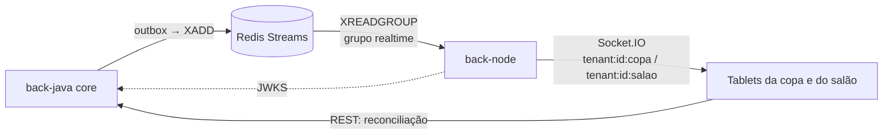

# QuickOrder — back-node

Serviço de **tempo real** do QuickOrder, sistema web para restaurantes com gestão de mesas,
comandas e pedidos em tempo real.

Consome os eventos publicados pelo core ([`back-java`](../back-java)) no Redis Streams e
notifica copa e salão via **Socket.IO**. Não grava estado de negócio: o core é o único dono do
pedido, e o Node só transmite (ou chama a API do core quando precisar).

> **Estado atual:** base do projeto (estrutura, configuração validada, `/health`, `/ready`,
> testes e Docker). Socket.IO, validação do JWT e consumo dos streams ainda não foram
> implementados: cada pasta tem um `index.ts` com a descrição em TSDoc da sua responsabilidade.

## Sumário

- [Arquitetura](#arquitetura)
- [Stack](#stack)
- [Estrutura do repositório](#estrutura-do-repositório)
- [Como rodar](#como-rodar)
- [Scripts](#scripts)
- [Variáveis de ambiente](#variáveis-de-ambiente)
- [Endpoints](#endpoints)
- [Tempo real](#tempo-real)
- [Segurança](#segurança)
- [Convenções](#convenções)
- [CI/CD e deploy](#cicd-e-deploy)
- [Próximos passos](#próximos-passos)

## Arquitetura



- O core grava o evento na `outbox` na mesma transação da mudança e publica no Redis depois
  do commit.
- O Node lê os streams no consumer group `realtime` e repassa para as rooms do tenant.
- **Eventos são dicas**: o front recarrega o estado pelo REST do core ao conectar e reconectar.
  O Redis da fase gratuita é só memória, e um restart apaga os streams.

## Stack

| Item              | Versão                                              |
| ----------------- | --------------------------------------------------- |
| Node.js           | 24 LTS (`.nvmrc`)                                   |
| Linguagem         | TypeScript 5.9 em modo `strict`, ESM                |
| HTTP              | Fastify 5                                           |
| Tempo real        | Socket.IO 4                                         |
| Redis             | ioredis 6                                           |
| JWT               | jose 6 (validação local pelo JWKS do core)          |
| Configuração      | zod 4                                               |
| Logs              | pino 10 (JSON)                                      |
| CORS e rate limit | `@fastify/cors`, `@fastify/rate-limit`              |
| Qualidade         | ESLint 10 + typescript-eslint, Prettier 3, Vitest 5 |
| Gerenciador       | npm com `package-lock.json` e versões exatas        |

## Estrutura do repositório

```text
back-node/
├── src/
│   ├── server.ts               entrada: valida a config, sobe o servidor e trata SIGTERM/SIGINT
│   ├── app.ts                  monta o Fastify (testável com app.inject, sem abrir porta)
│   ├── config/
│   │   └── env.ts              variáveis de ambiente validadas com zod (falha rápido)
│   ├── plugins/                Redis; a criar: JWT (JWKS), Socket.IO, CORS, rate limit
│   ├── modules/
│   │   ├── realtime/           consumo de events:pedido e events:mesa e broadcast por room
│   │   ├── cardapio/           leitura do cardápio com cache (fase paga)
│   │   └── integracoes/        canais externos (WhatsApp, iFood), futuros
│   └── shared/                 tipos do envelope de eventos e utilitários
├── test/                       testes (Vitest)
├── Dockerfile                  multi-stage, node:24-slim, usuário não-root
├── docker-compose.yml          só o node, na rede "quickorder" do back-java
└── .env.example
```

## Como rodar

### Pré-requisitos

- Docker com Docker Compose v2.
- Para rodar fora do Docker: Node.js 24 (`nvm use` lê o `.nvmrc`).
- O compose do [`back-java`](../back-java) de pé: ele cria a rede `quickorder`, o Redis e o core.

### Com Docker

```bash
# 1. no back-java
docker compose up -d

# 2. aqui
docker compose up -d --build
curl http://localhost:3000/health
curl http://localhost:3000/ready
```

Para trocar a porta exposta: `NODE_PORT=3001 docker compose up -d`.

### Fora do Docker

Com o Redis do `back-java` de pé (`docker compose up -d redis`, no `back-java`):

```bash
npm ci
cp .env.example .env
npm run dev          # recarrega a cada alteração e lê o .env se ele existir
```

### Build de produção

```bash
npm run build && npm start
docker build -t quickorder-node:local .
```

## Scripts

| Script                            | O que faz                                           |
| --------------------------------- | --------------------------------------------------- |
| `npm run dev`                     | sobe com `--watch` e `tsx`, lendo o `.env`          |
| `npm run build`                   | compila `src/` para `dist/` (`tsconfig.build.json`) |
| `npm start`                       | roda `dist/server.js`                               |
| `npm run lint`                    | ESLint                                              |
| `npm run format` / `format:check` | Prettier (corrige / só verifica)                    |
| `npm run typecheck`               | `tsc --noEmit` em `src/` e `test/`                  |
| `npm test`                        | Vitest                                              |

## Variáveis de ambiente

Validadas em `src/config/env.ts` na subida. Se faltar alguma obrigatória ou algum valor for
inválido, o processo não sobe e lista os problemas.

| Variável           | Obrigatória | Padrão        | Descrição                                                               |
| ------------------ | ----------- | ------------- | ----------------------------------------------------------------------- |
| `REDIS_URL`        | sim         | —             | Redis com os streams do core                                            |
| `JWKS_URL`         | sim         | —             | JWKS do core para validar o JWT (`http://<core>/.well-known/jwks.json`) |
| `NODE_ENV`         | não         | `development` | `development`, `test` ou `production`                                   |
| `PORT`             | não         | `3000`        | porta HTTP                                                              |
| `LOG_LEVEL`        | não         | `info`        | nível do pino                                                           |
| `CORS_ORIGINS`     | não         | vazio         | origens do front permitidas, separadas por vírgula                      |
| `TRUST_PROXY_HOPS` | não         | `1`           | proxies confiáveis à frente do serviço; `0` desliga                     |

O `.env` não é versionado. Nenhum segredo real deve entrar no repositório.

## Endpoints

| Rota          | Uso                            | Resposta                                         |
| ------------- | ------------------------------ | ------------------------------------------------ |
| `GET /health` | liveness; não depende de nada  | `200 {"status":"UP"}`                            |
| `GET /ready`  | readiness; faz `PING` no Redis | `200 {"status":"UP"}` ou `503 {"status":"DOWN"}` |

## Tempo real

Contrato dos eventos: [`back-java/docs/events`](../back-java/docs/events/README.md).

- Streams `events:pedido` e `events:mesa`; consumer group `realtime`, criado na subida de forma
  idempotente (`XGROUP CREATE ... MKSTREAM`, ignorando `BUSYGROUP`).
- Consumidor idempotente por `eventId`.
- Rooms por tenant: `tenant:{id}:copa` e `tenant:{id}:salao`. Todo `pedido.*` vai para as duas;
  `mesa.status_alterado` vai só para `salao`. Não há room por garçom.
- O front guarda a última `pedidoVersion` de cada pedido e descarta evento com versão menor
  ou igual.
- Só o transporte `websocket`. O adapter Redis do Socket.IO só entra com mais de uma instância.

## Segurança

- JWT RS256 emitido pelo core, validado **localmente** com `jose` a partir do JWKS (sem chamar o
  core a cada requisição), no HTTP e no handshake do Socket.IO.
- O token do WebSocket vai no `auth` do handshake, **nunca na query string**.
- O `tenant_id` vem sempre do token; o cliente nunca escolhe a room.
- CORS restrito à origem do front e rate limit em memória (instância única).
- Atrás do proxy do Render, `trustProxy` numérico (`TRUST_PROXY_HOPS`), nunca `true`, com o IP
  do cliente resolvido pelo mesmo critério do core.

## Convenções

- Branch `main` protegida, PR obrigatório, squash merge e histórico linear.
- Commits em [Conventional Commits](https://www.conventionalcommits.org/pt-br/)
  (`feat:`, `fix:`, `docs:`, `chore:`...).
- Dependências com versão exata (`save-exact=true` no `.npmrc`) e `npm ci` com o lockfile.
- Configuração só por variável de ambiente (12-factor); `.env.example` versionado.
- Finais de linha LF (`.gitattributes`) e `.editorconfig`.

## CI/CD e deploy

Planejado (ainda não implementado neste repositório):

- **CI (GitHub Actions)** em PR e push na `main`: setup-node pelo `.nvmrc` com cache do npm,
  `npm ci`, lint, typecheck, test e build; Trivy na imagem e revisão de dependências.
- **CD**: imagem `linux/amd64` publicada no GHCR com a tag do SHA e deploy no Render por deploy
  hook.

## Próximos passos

- [ ] Pipeline de CI no GitHub Actions.
- [ ] Plugins de CORS e rate limit.
- [ ] Validação do JWT pelo JWKS do core (HTTP e handshake).
- [ ] Socket.IO ligado ao servidor do Fastify 5 (o `fastify-socket.io` só suporta Fastify 4).
- [ ] Consumo dos streams e broadcast por room.
- [ ] Tipos do envelope de eventos em `shared/`.
